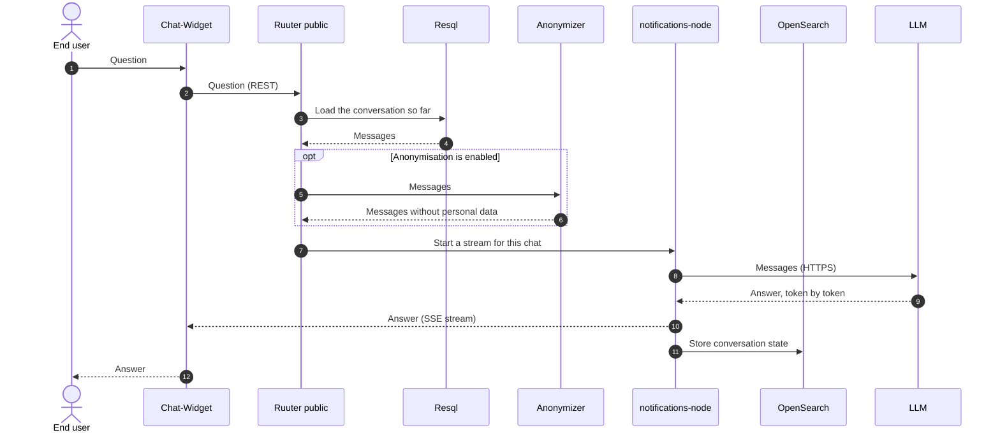
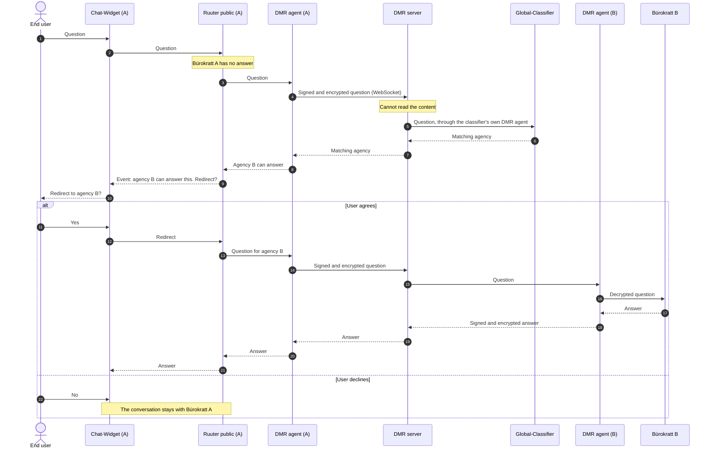
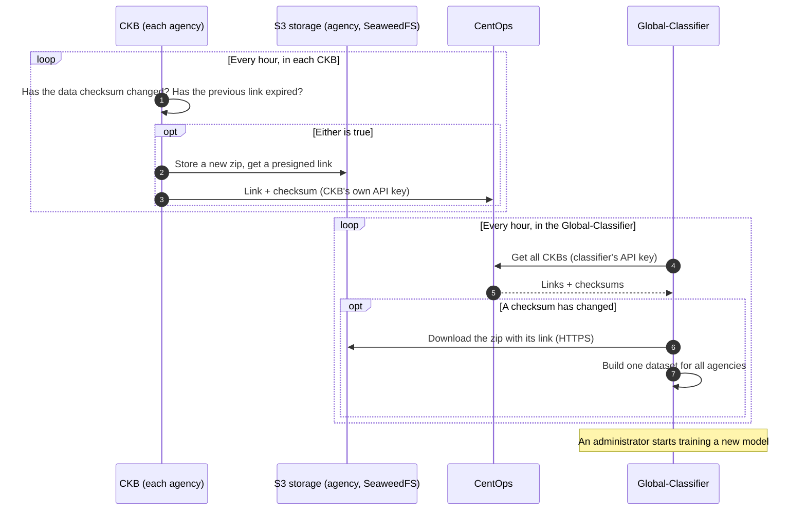

# Data journey

How a question travels through Bürokratt. Component names match the [overview diagram](README.md#overview).

## 1. An end user gets an answer

The answer comes from an LLM (currently Azure OpenAI) and reaches the widget as a stream. The diagram is simplified: Ruuter also runs intent detection and can trigger a service instead of asking the LLM.

When the LLM module is enabled for the installation, notifications-node requests the stream from the LLM Orchestration Service in LLM-Module instead of calling the LLM directly.

## 2. Another agency answers: the Bürokratt network

If one agency's Bürokratt cannot answer, it asks the network who can. The user must agree before the conversation is redirected.

The DMR server routes through RabbitMQ and gets the list of network members from CentOps.

## 3. How the Global-Classifier gets its data

The classifier learns each agency's topics from that agency's knowledge base (CKB). CKB data never travels through the DMR or CentOps; only the download link and the checksum do.

Downloading the zip is the classifier's only connection into an agency's storage. An agency that fails does not stop the others. CentOps lets each CKB update only its own entry.
