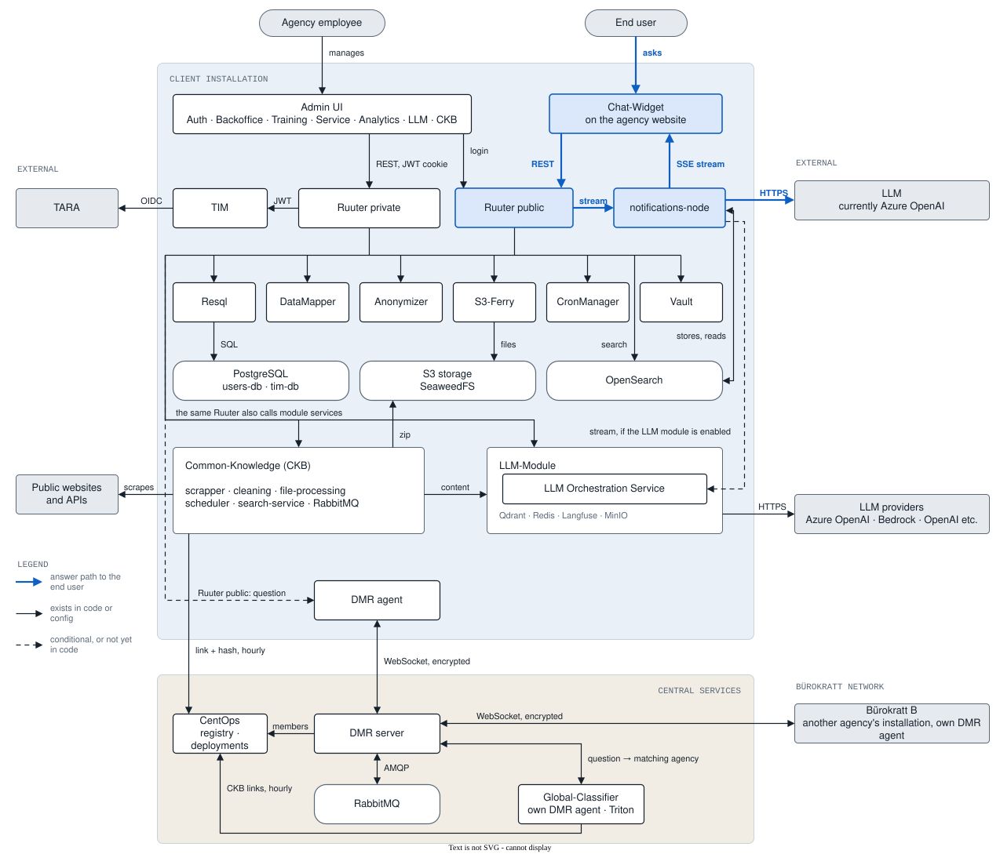

# Bürokratt architecture

What one Bürokratt installation contains, what runs centrally, and how the two talk to each other.

This description was agreed on 2026-10-22. Parts that are agreed but not yet in the code are drawn with dashed lines and listed in [Implementation status](implementation-status.md).

- [Overview](#overview)
- [Components](#components)
- [Data journey](data-journey.md): how a question gets its answer, inside one installation and across the Bürokratt network
- [Implementation status](implementation-status.md): where the code does not yet match this description, and what is needed for classification over DMR

## Overview

The diagram has three zones.

**Client installation.** Everything one agency runs. One installation means one Admin UI, one Ruuter private, one Resql and one database; all modules share the same Bükstack components. LLM-Module, Common-Knowledge (CKB) and the DMR agent are part of every installation.

**Central services.** CentOps, the DMR server and the Global-Classifier run once for the whole network and are not shipped with an installation.

**External.** TARA for authentication, the LLM that produces answers (currently Azure OpenAI), LLM providers used by LLM-Module, public websites that CKB collects content from, and other agencies' Bürokratt installations.

The blue path is how an end user gets an answer: Chat-Widget sends the question to Ruuter public, Ruuter public starts a stream in notifications-node, notifications-node asks the LLM and streams the answer back to the widget over SSE.

Ruuter calls the Bükstack services as the module DSLs direct. The diagram draws that as one bus line instead of one arrow per call.

Out of scope for this diagram: X-Road (XTR), the infrastructure layer (Kubernetes, ingress, Istio, storage) and helpdesk integrations.

### Editing the diagram

`img/overview.drawio.svg` is both the picture and its source. Open it in [draw.io](https://app.diagrams.net) (web, desktop, or the VS Code Draw.io Integration extension), edit, and save it under the same name. Do not export to plain SVG or PNG; that drops the editable source. The same applies to `img/dmr-global-classifier.drawio.svg`.

## Components

### Client installation

| Component | Role | Repository | Port |
|---|---|---|---|
| Chat-Widget | Chat window on the agency website | [Chat-Widget](https://github.com/buerokratt/Chat-Widget) | |
| Admin UI | One UI per installation: login, conversations, training, services, analytics, LLM and knowledge base settings | [Authentication-Layer](https://github.com/buerokratt/Authentication-Layer), [Buerokratt-Chatbot](https://github.com/buerokratt/Buerokratt-Chatbot), [Training-Module](https://github.com/buerokratt/Training-Module), [Service-Module](https://github.com/buerokratt/Service-Module), [Analytics-Module](https://github.com/buerokratt/Analytics-Module), [LLM-Module](https://github.com/buerokratt/LLM-Module), [Common-Knowledge](https://github.com/buerokratt/Common-Knowledge) | |
| Ruuter public | Public API. Executes the steps of a module's YAML DSL. Admin UI login also goes through it | [Ruuter](https://github.com/buerokratt/Ruuter) | 8080 |
| Ruuter private | Admin API. Every request is checked against TIM | [Ruuter](https://github.com/buerokratt/Ruuter) | 8080 |
| TIM | Authentication through TARA, issues and validates Bürokratt's own JWT | [TIM](https://github.com/buerokratt/TIM) | 8085 |
| notifications-node | SSE channel to the widget. Requests the answer from the LLM or from LLM-Module and streams it. Stores conversation state in OpenSearch and reads it back | [Buerokratt-Chatbot](https://github.com/buerokratt/Buerokratt-Chatbot) (`notification-server`) | 4040 |
| Resql | SQL queries exposed over REST | [Resql](https://github.com/buerokratt/Resql) | 8082 |
| DataMapper | Data transformation with Handlebars templates | [DataMapper](https://github.com/buerokratt/DataMapper) | 3000 |
| Anonymizer | Removes personal data before text is sent to the LLM | [Presidio-Anonymizer](https://github.com/buerokratt/Presidio-Anonymizer) | 8089 |
| CronManager | Scheduled jobs; calls Ruuter | [CronManager](https://github.com/buerokratt/CronManager) | 9010 |
| S3-Ferry | Moves files between S3 storage and disk | [S3-Ferry](https://github.com/buerokratt/S3-Ferry) | 3000 |
| Vault | Secrets, including LLM keys per domain | HashiCorp Vault | 8200 |
| PostgreSQL | `users-db` for module data, `tim-db` for TIM | | 5432 |
| OpenSearch | Search and conversation state | | 9200 |
| S3 storage | Files; SeaweedFS | | |
| LLM-Module | Routes a query to a workflow (service, context, RAG, API tool) and generates the answer | [LLM-Module](https://github.com/buerokratt/LLM-Module) | 8100 |
| Common-Knowledge (CKB) | Collects and cleans content from public sources for the LLM. Packs its data into a zip and reports the link and checksum to CentOps | [Common-Knowledge](https://github.com/buerokratt/Common-Knowledge) | |
| DMR agent | Signs, encrypts and relays messages to the central DMR server | [DMR](https://github.com/buerokratt/DMR) (`apps/dmr-agent`) | |

### Central services

| Component | Role | Repository |
|---|---|---|
| CentOps | Two roles. It is the registry of the network: the agencies, each CKB's download link and checksum, API keys; the DMR server and the Global-Classifier read from it. It is also the layer that deploys Bürokratt software to installations; that role is outside this diagram | [CentOps](https://github.com/buerokratt/CentOps) |
| DMR server | Relays encrypted messages between DMR agents through RabbitMQ. Does not read or store them | [DMR](https://github.com/buerokratt/DMR) (`apps/dmr-server`) |
| Global-Classifier | Trains one model from all agencies' CKB data and answers, through its own DMR agent, which agency can answer a question | [Global-Classifier](https://github.com/buerokratt/Global-Classifier) |

More detail on individual modules: [LLM-Module architecture](https://github.com/buerokratt/LLM-Module/blob/main/docs/ARCHITECTURE.md), [Common-Knowledge architecture](https://github.com/buerokratt/Common-Knowledge/blob/main/ARCHITECTURE.md).

Architectural decision records for CentOps, DMR and the data pipelines are in [Architectural-Decision-Records-ADR](../../Architectural-Decision-Records-ADR).

## Delivery pipeline

The architecture of the delivery pipeline, how Bürokratt software reaches the test, stage and prod clusters, is described in [Delivery pipeline](delivery/delivery.md).
