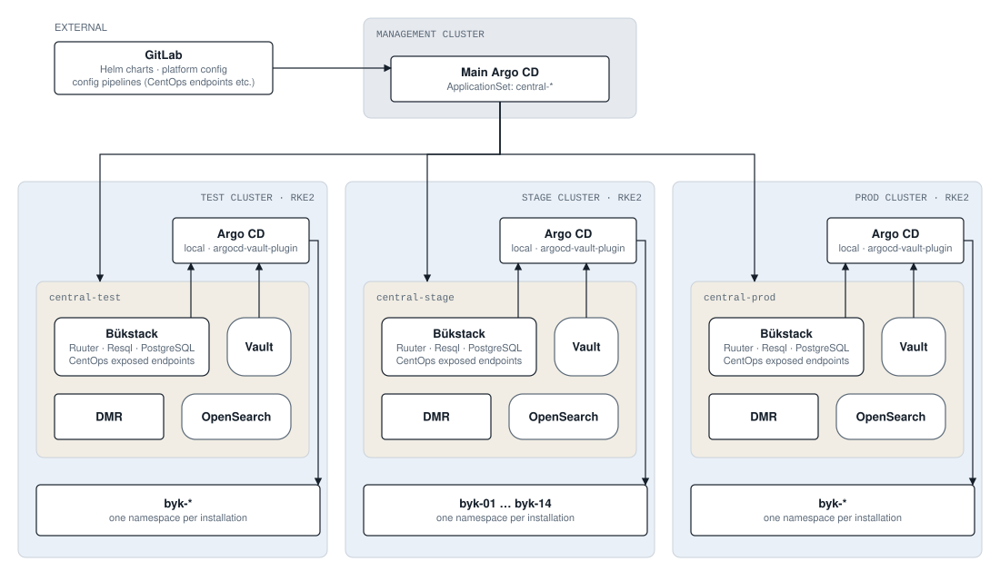
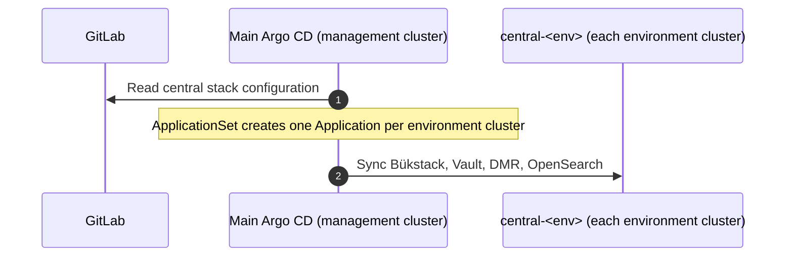
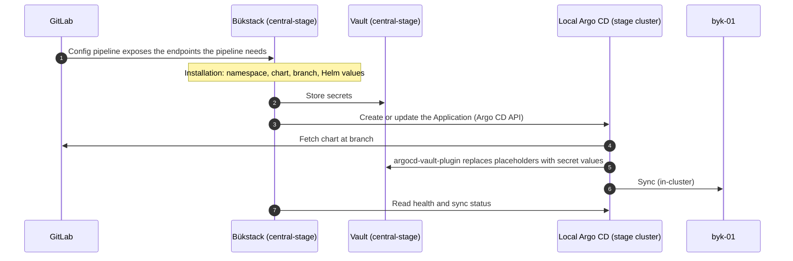

# Delivery pipeline

How Bürokratt software reaches the clusters where installations run. Component names match the [overview diagram](README.md#overview).

This design was agreed on 2026-10-19 and is being built. It replaces delivery with `helm install` from local machines; the target clusters run RKE2.

- [Overview](#overview)
- [Components](#components)
- [How the pipeline runs](#how-the-pipeline-runs)

## Overview

**Management cluster.** Runs only the main Argo CD. It installs the central stack `central-<environment>` into every environment cluster from configuration in GitLab. It does not deploy installations.

**Environment clusters.** Test, stage and prod, each an RKE2 cluster. Every cluster has its own central stack (`central-test`, `central-stage`, `central-prod`) and, outside it, a local Argo CD. Each installation runs in its own namespace; the stage cluster has 14 (`byk-01` … `byk-14`).

**Isolation.** The local Argo CD takes instructions only from the CentOps endpoints in the same cluster and deploys only to that cluster (destination `in-cluster`). The test environment knows nothing about the prod cluster or its central stack. If the management cluster or one environment fails, the other environments keep running and keep deploying.

**Rejected alternatives.** Everything in the management cluster; or the central stacks in the management cluster with one shared Bükstack and Argo CD. Both make the management cluster a single point of failure for every environment.

### Editing the diagram

`img/delivery.drawio.svg` is both the picture and its source; edit it in [draw.io](https://app.diagrams.net) as described in the [overview](README.md#editing-the-diagram).

## Components

| Component | Where | Role |
|---|---|---|
| GitLab | External | Helm charts of Bürokratt, the configuration of the central stack, and config pipelines that expose the endpoints the pipeline needs (for example the CentOps endpoints) |
| Main Argo CD | Management cluster | Installs and updates the central stack in each environment cluster |
| Local Argo CD | Environment cluster, outside `central-<env>` | Renders the chart from GitLab and deploys it to the installation's namespace in the same cluster |
| Vault | `central-<env>` | Secrets of installations; read during rendering by argocd-vault-plugin |
| Bükstack | `central-<env>` | Ruuter, Resql and the central PostgreSQL database. Ruuter exposes the CentOps endpoints that tell the local Argo CD which installations to deploy, with which chart and values |
| DMR | `central-<env>` | DMR server for the installations of this environment |
| OpenSearch | `central-<env>` | Search and logs for this environment |
| Installation | `byk-NN` | One Bürokratt installation as described in the [overview](../README.md#client-installation) |

## How the pipeline runs

Delivery happens on two levels: the main Argo CD delivers the central stack, and in each cluster the local Argo CD delivers installations.

### 1. Central stack

1. The configuration of the central stack is kept in GitLab.
2. An ApplicationSet in the main Argo CD generates one Application per environment cluster, with `central-<env>` as the destination namespace.
3. The main Argo CD syncs each Application into its cluster. A change in GitLab reaches the clusters through the same sync.

### 2. Installations

1. The Helm charts of Bürokratt are kept in GitLab.
2. GitLab config pipelines expose the endpoints the pipeline needs in the Bükstack of each central stack.
3. Through these endpoints, the installation is described: namespace, chart repository, path and branch, and the Helm values. Secrets go to Vault; the Helm values refer to them only as argocd-vault-plugin placeholders, so no secret value is stored in git.
4. On deploy, the endpoints create or update one Argo CD Application for the installation in the local Argo CD.
5. The local Argo CD fetches the chart from GitLab, argocd-vault-plugin fills in the secrets from Vault, and the chart is rendered.
6. The local Argo CD applies the result to the installation's namespace in the same cluster. Sync is automated with prune and self-heal, so the namespace keeps matching what was rendered, and new commits on the chart branch are deployed without another deploy.
7. Health and sync status are read back from the local Argo CD through the same endpoints.

A new version reaches an environment when the installation is pointed at a new chart branch or new values through the endpoints of that environment and deployed again. Each environment is deployed from its own central stack; nothing is pushed from one environment to another.
