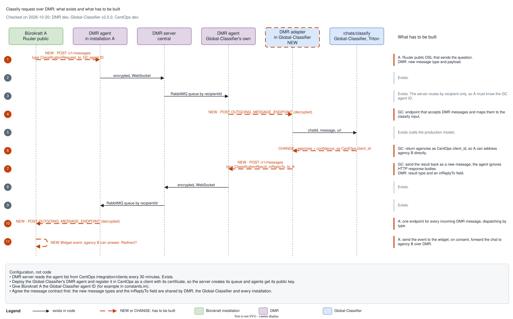

# Implementation status

Where the code differs from the [architecture description](README.md). Checked on 2026-10-20 against the default branches and the active development branches (CentOps `dev`, Global-Classifier `v2.0.0`, DMR `dev`). Update this page when an item is closed.

## Differences

| Area | Described | In code |
|---|---|---|
| Shared stack | All modules use one Ruuter, Resql, TIM and database per installation | The Helm charts of LLM-Module and Common-Knowledge ship their own Ruuter, Resql, TIM and database. `NoOps/helm_deploy_v2` does not install these two modules |
| DMR agent | Part of every installation; Ruuter public hands it questions | No chart in NoOps. No Ruuter public DSL calls the agent's `/v1/messages` endpoint |
| Global-Classifier and DMR | The classifier answers classify requests through its own DMR agent | DMR has one message type, `ChatMessage`, with a chat payload; there is no type for a classify request or result and no field linking a reply to its request. The DMR server routes only by `recipientId`. The Global-Classifier has REST endpoints (`/chats/classify`, `/chats/incoming`) but no endpoint that receives DMR messages, and no DMR agent deployment |
| Global-Classifier and CentOps | The classifier reads CKB links and checksums from CentOps every hour | CentOps `dev` has the endpoints (`integration/clients`, `integration/global-classifier/common-knowledge-bases`). The Global-Classifier sync on `v2.0.0` still reads a mock table instead of CentOps |
| Rasa | No longer used; answers come from an LLM | `message-to-bot.yml` in Buerokratt-Chatbot still calls `CHATBOT_BOT`, and `NoOps/helm_deploy_v2/components.yaml` still installs the Bot and Train-bot charts |

## Classification over DMR

Step 3 of the [Bürokratt network flow](data-journey.md#2-another-agency-answers-the-bürokratt-network) sends a question from an installation to the Global-Classifier through DMR and gets the matching agency back. The transport is in place; the message contract and the endpoints on both ends are not.

### In place

- The DMR agent encrypts messages; the DMR server routes them to the recipient's RabbitMQ queue by `recipientId`.
- The DMR server reads the agent list from CentOps (`integration/clients`).
- The Global-Classifier exposes `/chats/classify`, which calls the production model.
- CentOps uses one identifier, `client_id`, for an agency's DMR agent and for its knowledge base entry.

### To build

| Side | Work |
|---|---|
| DMR | Message types for the classify request and its result (for example `ClassificationRequest` and `ClassificationResult`) with their payloads. Today the only type is `ChatMessage`, and the agent rejects fields outside the chat payload. |
| DMR | A field that links a reply to its request, for example `inReplyTo`. A reply is a separate message that arrives later. |
| Global-Classifier | An endpoint for its DMR agent's `OUTGOING_MESSAGE_ENDPOINT` that maps the incoming message to the `/chats/classify` input and sends the result back through its agent's `POST /v1/messages`. The agent does not read HTTP response bodies, so the result cannot be returned synchronously. The diagram calls this a DMR adapter; it can also be built as a Ruuter endpoint in the Global-Classifier. |
| Global-Classifier | Return agencies as CentOps `client_id`, so the installation can use the result as the `recipientId` for agency B. |
| Installation (Ruuter public) | A DSL that sends the question to the DMR agent, and one endpoint for the agent's `OUTGOING_MESSAGE_ENDPOINT` that handles every incoming DMR message by type: a classify result becomes a widget event, an answer from agency B goes into the chat, a question from another agency goes into the local chat flow. |

### Configuration

- Deploy the Global-Classifier's DMR agent and register it in CentOps as a client with its certificate, so the DMR server creates its queue and other agents get its public key.
- Give each installation the Global-Classifier's agent ID, for example in `constants.ini`. The DMR server routes by recipient only, so no server change is needed for this.

The message contract is shared by DMR, the Global-Classifier and every installation, so it should be agreed before work on either end starts.
